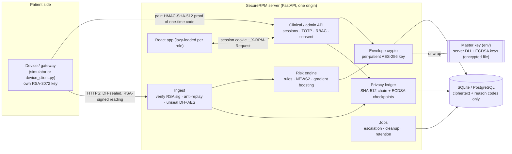

# Architecture

## Components



## A reading's journey

```mermaid
sequenceDiagram
  participant D as Device
  participant S as Server
  participant DB as Database
  D->>D: e = random, E = g^e mod p (ffdhe3072)
  D->>D: K = HKDF-SHA-512(S_pub^e) ; c = AES-256-GCM(K, vitals, AAD=header)
  D->>D: sig = RSA-PSS(SHA-512(header ‖ E ‖ nonce ‖ c))
  D->>S: POST /api/ingest {header, E, nonce, c, sig}
  S->>S: verify sig with the device's public key
  S->>S: |now - ts| ≤ 60 s and seq > last_seq (atomic)
  S->>S: K = HKDF(E^s) → decrypt → validate ranges
  S->>S: score (rules + NEWS2 + model, encrypted baseline)
  S->>DB: AES-256-GCM(patient DEK, vitals, AAD=patient|device|seq|ts)
  S->>DB: update encrypted 5-min rollup, band, reason codes, alerts
```

## Data at rest

| Table | In clear | Encrypted (AES-256-GCM) |
|---|---|---|
| `patients` | ids, consent flag, last band/score | DEK (under master key), DOB, phone, address, ML baseline |
| `readings` | patient, device, seq, timestamp, band, risk, reason codes | vital signs + NEWS2 (under patient DEK) |
| `reading_rollups` | patient, 5-min bucket, worst band | count / sum / min / max per vital |
| `alerts` | reason code, severity, status, times | acknowledgement note |
| `users` | username, name, role | TOTP secret (under master key); password = PBKDF2-HMAC-SHA-512 |
| `recovery_codes` | – | PBKDF2-HMAC-SHA-512 hashes only |
| `sessions` | – | SHA-512 of the cookie token only |
| `audit_log` | full rows | – (integrity via hash chain + signatures) |

## Concurrency and multi-process safety

| Concern | Mechanism |
|---|---|
| Audit chain forks | `UNIQUE(prev_hash)`: a racing append fails and retries on the new head |
| Duplicate open alerts | partial unique index on `(patient_id, reason_code) WHERE status='open'` |
| Replayed readings | `UPDATE devices SET last_seq=? WHERE last_seq < ?` (compare-and-set) |
| TOTP code reuse | `UPDATE users SET totp_last_step=? WHERE totp_last_step < ?` |
| Rate limits | fixed-window counters in `rate_limits` |
| Jobs in several processes | every job step is an idempotent conditional update |

## Code map

| Area | Files |
|---|---|
| Crypto primitives (unchanged techniques) | `backend/app/security/{aead,sealing,signatures,crypto,hashing}.py` |
| Protocols | `security/pairing.py`, `readings/ingest.py`, `security/audit.py`, `readings/rollups.py` |
| Auth & access | `security/auth.py`, `security/rbac.py` |
| API | `api/{auth_routes,patients,admin,devices,imports,ingest_routes}.py` |
| ML | `ml/{rules,features,infer,synth,train,realdata,eval_real}.py` |
| Ops | `jobs.py`, `logging_setup.py`, `migrations/`, `Dockerfile`, `.github/workflows/ci.yml` |
| Frontend | `frontend/src/pages/*`, `frontend/src/components/*`, tests in `src/test` and `e2e/` |
